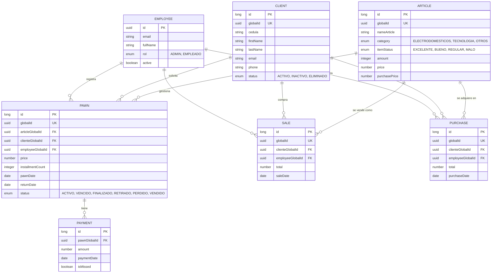

# 📊 Modelo de Datos y Entidad-Relación (ERD)

Este documento define la estructura de datos del sistema FrontCompraVenta, asegurando la integridad y coherencia entre el frontend y el backend.

## 1. Diagrama Entidad-Relación (ERD)

## 2. Diccionario de Datos Detallado

### 2.1 Entidad: Empleado (Employee)
| Campo | Tipo | Restricción | Descripción |
| :--- | :--- | :--- | :--- |
| `id` | UUID | Primary Key | Identificador único interno. |
| `email` | String | Unique, Not Null | Correo electrónico para acceso. |
| `fullName` | String | Not Null | Nombre completo del empleado. |
| `rol` | Enum | ADMIN, EMPLEADO | Define los permisos de acceso. |
| `active` | Boolean | Not Null | Estado de la cuenta. |

### 2.2 Entidad: Cliente (Client)
| Campo | Tipo | Restricción | Descripción |
| :--- | :--- | :--- | :--- |
| `globalId` | UUID | Unique Key | ID público para integraciones y URL. |
| `cedula` | String | Unique | Documento de identidad. |
| `firstName` | String | Not Null | Nombre del cliente. |
| `lastName` | String | Not Null | Apellido del cliente. |
| `status` | Enum | ACTIVO, INACTIVO, ELIMINADO | Estado administrativo del cliente. |

### 2.3 Entidad: Artículo (Article)
| Campo | Tipo | Restricción | Descripción |
| :--- | :--- | :--- | :--- |
| `globalId` | UUID | Unique Key | Identificador único del artículo. |
| `nameArticle` | String | Not Null | Nombre descriptivo del objeto. |
| `category` | Enum | ELECTRODOMESTICOS... | Categoría para reportes. |
| `amount` | Integer | >= 0 | Cantidad disponible en stock. |
| `price` | Number | > 0 | Precio sugerido de venta. |

### 2.4 Entidad: Empeño (Pawn)
| Campo | Tipo | Restricción | Descripción |
| :--- | :--- | :--- | :--- |
| `globalId` | UUID | Unique Key | Identificador del contrato. |
| `articleGlobalId`| UUID | FK $\rightarrow$ Article | Artículo empeñado. |
| `clienteGlobalId`| UUID | FK $\rightarrow$ Client | Dueño del artículo. |
| `price` | Number | > 0 | Monto del préstamo otorgado. |
| `status` | Enum | ACTIVO, VENCIDO... | Estado actual del contrato. |

---

## 3. Definición de Tipos de Datos (Frontend)

Para mantener la coherencia, dividimos los tipos en tres categorías según su flujo en la aplicación.

### 3.1 Tipos de Entrada (Requests)
Se utilizan en los formularios y se envían al backend.
- **`CreatePawnRequest`**: Datos necesarios para iniciar un empeño.
- **`LoginRequest`**: Credenciales de acceso.
- **`UpdateClienteRequest`**: Datos actualizables del cliente.

### 3.2 Tipos Internos (State)
Se utilizan para manejar la lógica de la UI y el estado temporal.
- **`PawnWizardState`**: Objeto que acumula los datos de los 4 pasos del asistente.
- **`AuthSession`**: Contiene el token, el perfil del empleado y los permisos.
- **`UITheme`**: Preferencias de visualización (Dark/Light).

### 3.3 Tipos de Salida (Responses)
Datos que llegan del backend y se renderizan en la UI.
- **`ApiResponse<T>`**: Envoltorio estándar `{ success: boolean, data: T, message: string, error: ErrorDetail }`.
- **`PawnResponse`**: Detalle completo del empeño para la vista de gestión.
- **`DashboardSummary`**: Conjunto de KPIs para la página principal.
