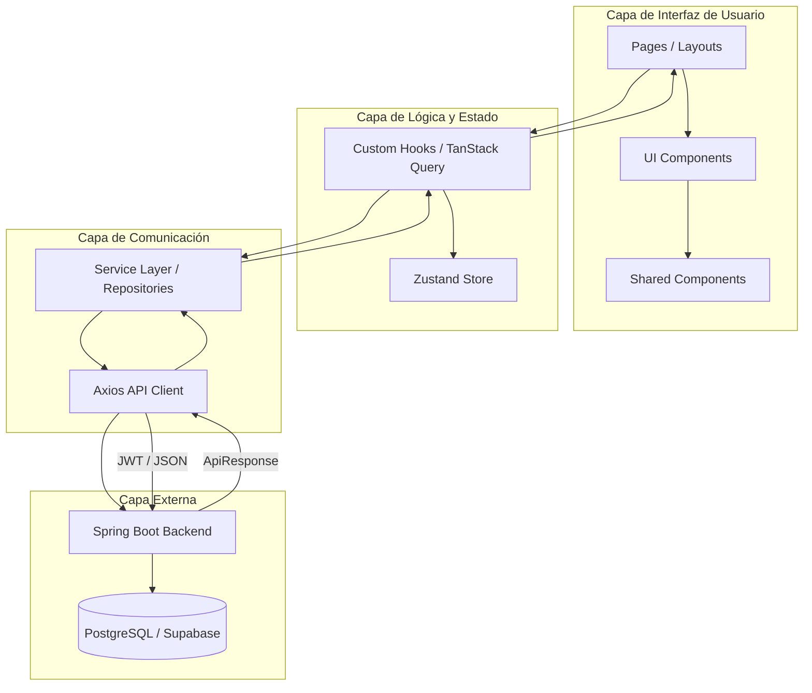

# 🏗️ Diagramas de Arquitectura y Dependencias

Este documento describe la organización estructural del sistema FrontCompraVenta, la jerarquía de sus componentes y cómo interactúan los módulos internos con las dependencias externas.

## 1. Diagrama Jerárquico de Arquitectura

El sistema utiliza una arquitectura de **Capas Desacopladas**. El flujo de datos es estrictamente unidireccional para evitar dependencias circulares y facilitar el mantenimiento.

---

## 2. Mapa de Módulos y Responsabilidades

Cada módulo está diseñado para tener una **Única Responsabilidad (SRP)**:

### 📦 Módulos Internos
| Módulo | Responsabilidad | Dependencias |
| :--- | :--- | :--- |
| `app/` | Definición de rutas, layouts y puntos de entrada de páginas. | `components`, `hooks` |
| `components/ui/` | Primitivos visuales básicos (estilo shadcn). | `tailwind` |
| `components/modules/` | Lógica de UI compleja (ej. `PawnWizard`). | `ui`, `hooks` |
| `hooks/` | Gestión de estado asíncrono y lógica de negocio del cliente. | `services`, `store` |
| `services/` | Definición de endpoints y transformación de datos API. | `api-client` |
| `store/` | Persistencia de estado global efímero (sesión, tema). | `zustand` |
| `types/` | Contratos de datos y interfaces de TypeScript. | `openapi-typescript` |

### 🔌 Dependencias Externas
| Dependencia | Propósito | Impacto |
| :--- | :--- | :--- |
| **Next.js 15** | Framework base, routing y renderizado. | Core |
| **TanStack Query** | Gestión de caché, sincronización y estados de API. | Crítico |
| **Axios** | Cliente HTTP con interceptores para JWT. | Crítico |
| **Zustand** | Gestión de estado global ligera. | Medio |
| **Zod** | Validación de esquemas de datos en tiempo de ejecución. | Alto |
| **shadcn/ui** | Librería de componentes accesibles y estilizados. | UI |

---

## 3. Flujo de Dependencias (Dependency Graph)

Para evitar el "acoplamiento fuerte", el sistema sigue esta regla de oro:
**"Una capa solo puede conocer a la capa inmediatamente inferior, nunca a una superior".**

**Flujo permitido:**
`UI Layer` $\rightarrow$ `Hook Layer` $\rightarrow$ `Service Layer` $\rightarrow$ `API Client` $\rightarrow$ `Backend`

**Prohibiciones estrictas:**
- ❌ Un componente de UI no puede llamar directamente a un Servicio (`article.service.ts`). Debe pasar por un Hook.
- ❌ Un Servicio no puede acceder al estado de Zustand directamente. Recibe los datos como parámetros.
- ❌ El `api-client` no conoce la lógica de negocio; solo sabe enviar y recibir JSON.
